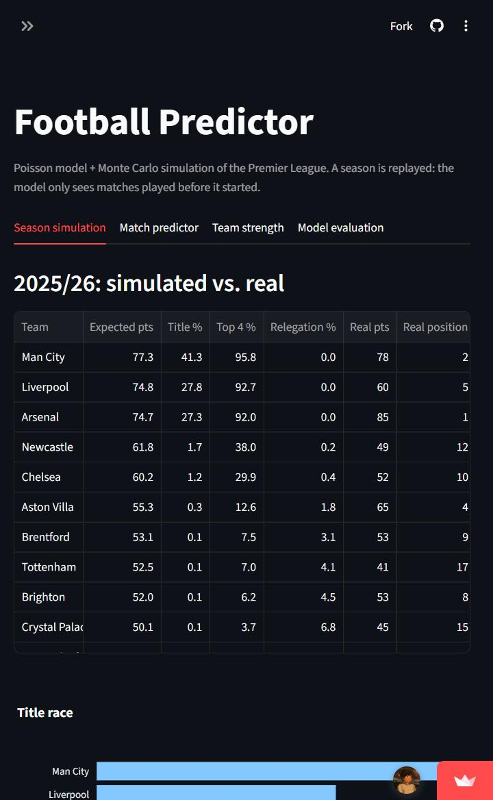
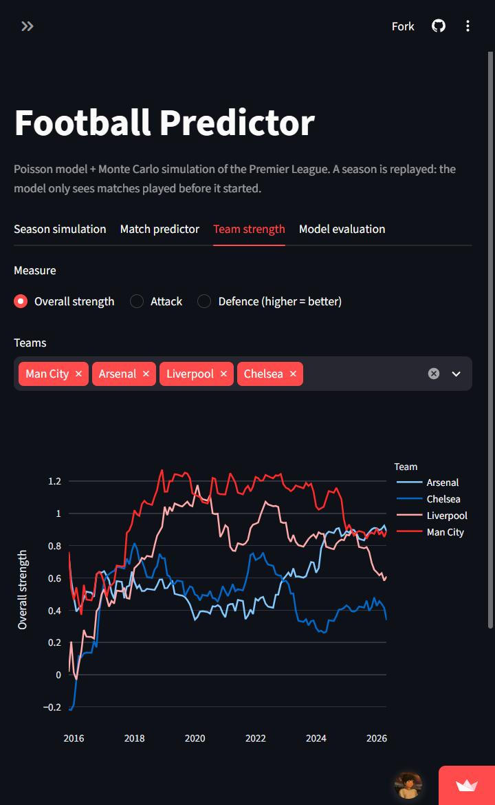
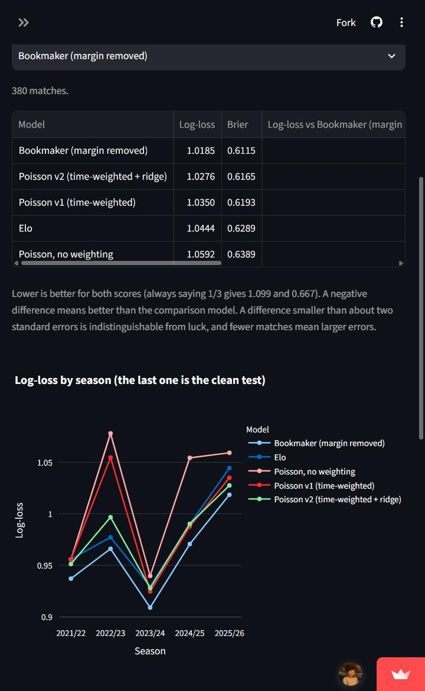

# Football Predictor

A Poisson-based model for Premier League matches, a Monte Carlo season simulation, and an honest backtest against bookmaker odds, all in a Streamlit dashboard.

**Live demo: <https://football-predictor-6eaqpvqnp88t7jhm92tbtr.streamlit.app>**

This is a personal learning project (Python, data science, Git, Claude Code), so the emphasis is on understanding the model and testing it fairly, not on beating the bookmakers. It is not betting advice.

| Season simulation | Team strength | Model evaluation |
|---|---|---|
|  |  |  |

## What the dashboard shows

- **Season simulation:** a season is replayed 10,000 times using only matches played before it started, and compared with the real final table (title, top 4 and relegation probabilities).
- **Match predictor:** home/draw/away probabilities and the scoreline grid for any two teams.
- **Team strength:** each team's attack, defence and overall strength month by month.
- **Model evaluation:** the Poisson model against an Elo baseline and the bookmaker, with standard errors and a calibration plot.

## The model in plain terms

**Goals as Poisson draws.** Goals in a match are rare and roughly independent, so each side's goals are modelled as a Poisson random number. The expected goals depend on the teams' strengths:

```
expected goals (home) = exp(base + home advantage + attack[home] + defence[away])
expected goals (away) = exp(base +                  attack[away] + defence[home])
```

A positive `defence` value means a team concedes more. The parameters are fitted by maximum likelihood on past matches. From the two expected-goals values, a grid of scoreline probabilities gives P(home win), P(draw) and P(away win).

**Recent matches count more.** Each match is weighted by `0.5 ** (age / 365 days)`, so a match a year old counts half as much as one played today.

**A ridge penalty.** Without it, a team with 0 goals in its first matches gets an attack strength that sinks towards minus infinity (it reached -20.85 for Cardiff in September 2018) and drags every other team with it. The penalty `(ridge / 2) * sum(effects squared)` keeps estimates finite. It is the same as assuming team effects are roughly Normal with a standard deviation of 0.5.

**Season simulation.** All 380 fixtures are drawn at once with numpy for 10,000 seasons (seeded, so reproducible), league tables are built with matrix products, and probabilities are simply frequencies over the simulated seasons. Newly promoted teams the model has never seen get average strength.

**Elo baseline.** Ratings update after every match (K = 25, home bonus 55 points) and an ordered-logit form turns the rating difference into home/draw/away probabilities.

## How the model is evaluated

- **Walk-forward, no leakage:** every match is predicted by a model fitted only on matches played strictly before it. Tests check this by altering future results and confirming the predictions do not change.
- **Bookmaker margin removed:** Bet365 implied probabilities `1 / odds` are divided by their sum, so they add up to exactly 1.
- **Scores:** log-loss and Brier score (lower is better). Always predicting 1/3 scores 1.099 and 0.667.
- **Paired standard errors:** each model is compared with the bookmaker on the same matches. A gap smaller than about two standard errors is indistinguishable from luck.
- **Three data roles:** seasons 2015/16 to 2017/18 are warm-up history, 2018/19 to 2020/21 are for choosing settings (validation), and the rest are for testing.

## Results

Data: 4,180 matches, 2015/16 to 2025/26. Log-loss, lower is better; the difference is against the bookmaker, plus or minus one standard error.

**Clean test, 2025/26 (380 matches).** This season had never been looked at when the final model (v2) was frozen.

| Model | Log-loss | Brier | Log-loss vs bookmaker |
|---|---|---|---|
| Bookmaker (margin removed) | 1.0185 | 0.6115 | |
| Poisson v2 (time-weighted + ridge) | 1.0276 | 0.6165 | +0.009 ± 0.008 |
| Poisson v1 (time-weighted) | 1.0350 | 0.6193 | +0.017 ± 0.012 |
| Elo | 1.0444 | 0.6289 | +0.026 ± 0.011 |
| Poisson, no weighting | 1.0592 | 0.6389 | +0.041 ± 0.011 |

**Seen seasons, 2021/22 to 2024/25 (1,520 matches).** Version 1 was scored once here, so these seasons are no longer a clean test for anything built afterwards; the v2 numbers are informational only.

| Model | Log-loss | Brier | Log-loss vs bookmaker |
|---|---|---|---|
| Bookmaker (margin removed) | 0.9458 | 0.5598 | |
| Elo | 0.9632 | 0.5716 | +0.017 ± 0.004 |
| Poisson v2 (time-weighted + ridge) | 0.9667 | 0.5740 | +0.021 ± 0.004 |
| Poisson v1 (time-weighted) | 0.9808 | 0.5749 | +0.035 ± 0.015 |
| Poisson, no weighting | 1.0070 | 0.5927 | +0.061 ± 0.015 |

**What this shows, and what it does not.**
- The bookmaker is best in every season tested. The final model is statistically level with it on the clean test (within about one standard error), but 380 matches can only detect large gaps, so "level" is not "better".
- Version 2 beat version 1 by 0.0075 ± 0.0067 on the clean test: suggestive, not proven.
- The story: version 1 was tuned on validation seasons and lost clearly on the first test. A strength chart then showed a spike across all teams, which traced back to the zero-goal instability above. Version 2 adds the ridge penalty, with its strength chosen on validation seasons only. On validation the penalty made no measurable difference on average, so it was adopted as a bug fix, not as a tuned improvement.
- Numbers are as of October 2026 and will go stale if the results files are regenerated.

## Run it yourself

```bash
pip install -r requirements.txt
python -m streamlit run app.py
```

The app downloads and cleans the match data on first start (about 10 seconds). To build it manually:

```bash
python -c "from src import data; data.build_dataset(data.DEFAULT_START_YEARS)"
```

Run the tests (139):

```bash
python -m pytest
```

Regenerate the saved results the dashboard reads (the second takes a few minutes):

```bash
python -c "import pandas as pd; from src import data, poisson; poisson.save_strength_history(pd.read_csv(data.PROCESSED_PATH, parse_dates=['date']))"
python -c "import pandas as pd; from src import data, backtest; backtest.save_test_predictions(pd.read_csv(data.PROCESSED_PATH, parse_dates=['date']))"
```

## Project structure

```
football-predictor/
├── app.py              # Streamlit dashboard (display only)
├── src/
│   ├── data.py         # downloading and cleaning football-data.co.uk CSVs
│   ├── poisson.py      # Poisson model: fit (weights, ridge), probabilities, strength history
│   ├── elo.py          # Elo baseline
│   ├── simulate.py     # Monte Carlo season simulation
│   └── backtest.py     # margin removal, metrics, walk-forward backtest, tuning
├── tests/              # pytest tests, one file per module plus an app smoke test
├── results/            # saved predictions and strength history read by the dashboard
├── docs/images/        # screenshots
├── data/               # downloaded and cleaned data (git-ignored)
└── requirements.txt
```

`results/test_predictions_v1.csv` keeps the original version 1 predictions unchanged, as a record of what was measured before the fix.

## Limitations and next ideas

- Newly promoted teams get average strength; real promoted teams are usually weaker. A prior estimated from past promotions could do better.
- Independent Poisson goals slightly misjudge low scores like 0-0 and 1-1 (a Dixon-Coles correction would address this).
- A blend of the Poisson and Elo probabilities might beat both.
- Only Bet365 pre-match odds are used; closing odds are sharper and a tougher benchmark.
- Uncertainty in the fitted strengths is not carried into the season simulation, so its probabilities are somewhat overconfident.
- Upcoming fixtures from the football-data.org API are not used yet; seasons are replayed.

## What building this taught

- **Leakage is easy to cause and worth testing for.** The rule "only matches strictly before the prediction" lives in one place and has tests that alter the future and check nothing moves.
- **Tune on one set, test on another, and say so.** The first test result was disappointing, and the honest response was to keep the record, fix the cause, and get a fresh season for the next test.
- **Charts find bugs that averages hide.** The ridge fix came from a spike in a chart, not from any aggregate score.
- **Always compare with a baseline and report uncertainty.** A 0.01 gap in log-loss means nothing without its standard error.

## Data and credits

Match results and bookmaker odds come from [football-data.co.uk](https://www.football-data.co.uk); the raw files are downloaded on demand and are not stored in this repository. Built with pandas, numpy, scipy, statsmodels, Streamlit and Plotly, as a learning project. Released under the licence in [LICENSE](LICENSE).
